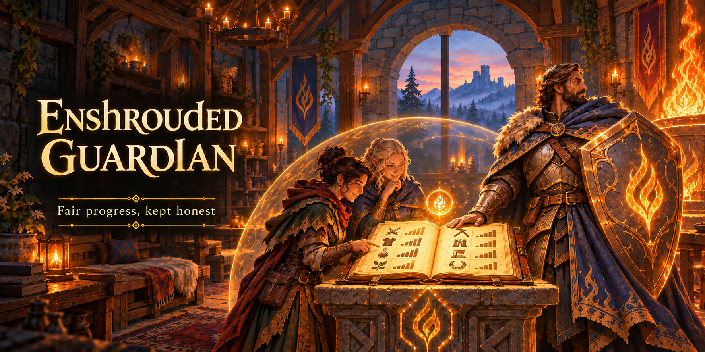

<p align="center">
  
</p>

<h1 align="center">Enshrouded Server Guardian</h1>

> **Os créditos pela criação original do Enshrouded Server Guardian pertencem a Nicolas Ferreira.**
> Este projeto surgiu da recompilação e expansão do [projeto original dele](https://github.com/nicolasferreiraxn/Enshrouded-Server-Guardian)
> e só existe porque Nicolas o criou e compartilhou antes. Nosso trabalho consiste
> em expandir as funcionalidades e manter esta versão ampliada, sem reivindicar
> a autoria da criação original. Os avisos de copyright e a licença são preservados.

## Contribuições humanas e de IA

O desenvolvimento desta versão ampliada combina contribuições humanas e de IA: parte do código foi ajustada com auxílio de inteligência artificial e parte foi ajustada diretamente por um ser humano. Isso não altera os créditos pela criação original indicados acima.

<p align="center">
  <b>Progresso justo no seu servidor dedicado.</b><br>
  O servidor passa a ser a autoridade sobre o personagem de cada jogador — e não o PC de quem entra.
</p>

<p align="center">
  <a href="../../actions/workflows/build.yml"></a>
  
  
  <a href="LICENSE"></a>
</p>

<p align="center">
  🇧🇷 Português · 🇺🇸 <a href="README.md">English</a>
</p>

---

> [!NOTE]
> **Atualização do jogo de novembro de 2026 (build 1285601): a v1.0.0 continua funcionando — não há nada para atualizar.**
> O guardião acha os ganchos por padrão de bytes, então sobreviveu a esta atualização do mesmo jeito que à anterior.
> Veja [Atualizações do jogo](#-atualizações-do-jogo) para saber o que acontece se uma atualização futura quebrar algo.

## 🔥 De onde veio

Quatro amigos num servidor dedicado. Dois problemas apareceram:

1. **Personagem de outro lugar.** O Enshrouded guarda o personagem no **cliente** e o envia ao entrar. Dava para
   jogar num mundo privado, se equipar lá e entrar no servidor compartilhado com aquele equipamento. Ou restaurar
   um backup local antigo e desfazer uma morte.
2. **Progresso acima do grupo.** Um jogador liberou receitas e itens de zonas muito à frente de onde o grupo
   estava. Limpar isso não adiantava enquanto qualquer um pudesse trazer de volta.

Os dois vêm da mesma raiz: **o cliente era a fonte de verdade do personagem**. O guardião inverte isso. O servidor
mantém a própria cópia do que gravou por último de cada jogador — e essa cópia vence.

## ✨ O que ele faz

| | |
|---|---|
| 💀 **Hardcore opcional** | após morrer, renasce no nível 1, sem XP, itens ou skills, mantendo conhecimento e voltando ao ponto inicial sem desconexão; desativado por padrão |
| 🛡️ **Servidor manda** | na entrada, compara o personagem que chegou com a última cópia do servidor e, se divergirem, devolve a cópia do servidor |
| 🎒 **Nada vem de fora** | equipamento, nível, árvore de habilidades, inventário, descobertas e receitas valem o que o servidor viu |
| 🔍 **Prova de tudo** | guarda o save recusado **e** a cópia de referência daquele instante, para comparar sem conclusão errada |
| 👀 **Modo observar** | registra cada divergência sem mudar nada — para medir antes de impor |
| ✅ **Troca conferida** | depois de escrever, relê e compara; se não pegou, registra a falha em vez de fingir |
| 🔧 **Sobrevive a atualizações** | ganchos achados por padrão de bytes, não por endereço fixo |
| 🧩 **Combina com o Save Editor** | edite a cópia de um jogador, expulse ele, e ele volta com a sua versão |

## Modo hardcore (3.2.0)

O modo hardcore aplica uma penalidade de progressão a cada morte. O reset ocorre quando o personagem renasce, sem expulsar ou desconectar o jogador.

### Como ativar ou desativar

Adicione `"hardcore": true` no nível principal do `guardian.json` existente, ao lado do executável do servidor dedicado, mantendo as outras configurações. O padrão é `false`. Para desativar, altere novamente para `false`. Reinicie o servidor após mudar essa configuração.

O hardcore requer um backend nativo de renascimento compatível no servidor dedicado. Sem ele, o reset por morte durante a sessão fica indisponível. Não exige alteração no cliente nem runtime EMF.

### O que acontece após uma morte

1. O backend nativo identifica a morte pelo hash da conta, e o Guardian verifica o SteamID e a conexão atual. Nome do jogador e proximidade nunca autorizam um reset.
2. Antes de alterar o personagem, a thread de backups do Guardian preserva a última referência do servidor e registra o reset pendente.
3. Quando o personagem renasce e está pronto para jogar, o backend nativo aplica o reset:

| Dado do personagem | Resultado |
| --- | --- |
| Nível | Retorna ao nível 1 |
| XP e XP pendente | Zerados |
| Inventário e equipamentos | Removidos do personagem |
| Skills desbloqueadas | Removidas, incluindo os efeitos de skills verificados |
| Conhecimento | Preservado |
| Posição | Teleporte ao ponto inicial `StartLocation` do mundo |

A regra também vale para administradores. Baús compartilhados da base não são esvaziados. O Guardian verifica o reset e o teleporte nativos e conclui a operação após a próxima gravação bem-sucedida do personagem. O reset por morte não usa a sequência de desconexão da primeira entrada com personagem de outro mundo.

### Backups e resets interrompidos

Os backups ficam em `guardian/<SteamID64>/hardcore/history/<token>/`. O arquivo `guardian/<SteamID64>/hardcore-pending.json` registra um reset ainda não concluído. Operações interrompidas permanecem pendentes e são reaplicadas na reconexão usando a referência do personagem no servidor, preservando seu conhecimento.

O backend aceita somente o executável dedicado verificado (timestamp PE `6aeb143e`, tamanho da imagem `0x1dde000`). Todos os patterns de bytes e RVAs necessários são conferidos antes da instalação dos hooks. Falhas na verificação de identidade, backup, layout dos componentes ou ponto inicial impedem a conclusão do reset afetado; são registradas em log e não solicitam kick automático. Se o backend não inicializar, o reset por morte durante a sessão fica indisponível.

## 🚀 Instalação

1. Abra **[Releases](https://github.com/edtereza/enshrouded-guardian/releases/latest)**.
2. Baixe guardian-{versão}.zip, gerado exclusivamente pela build do GitHub.
3. Pare o servidor e faça backup das DLLs e configurações existentes.
4. Extraia o pacote ao lado de enshrouded_server.exe e restaure/mescle seus JSONs.
5. Inicie o servidor e confira guardian/guardian.log.

O pacote atual utiliza Shroudtopia. Os instaladores antigos específicos de ambientes locais foram removidos.
As orientações abaixo sobre Wine/BisectHosting são referências do projeto original
e se aplicam à variante proxy, não ao pacote Shroudtopia distribuído pelo Actions.

### 🟣 Na BisectHosting

A BisectHosting tem um carregador de DLLs próprio, então o arquivo vai em outro lugar:

1. **Pare** o servidor.
2. Envie o **`dbghelp.dll`** para a pasta **`DLLMods/`** — **não** ao lado do `enshrouded_server.exe`.
3. Suba o servidor. A pasta `guardian/` e o `guardian.json` continuam ao lado do `enshrouded_server.exe`.

A ordem e o momento de carga podem ser ajustados em `DLLMods/chainloader.ini`, que também tem uma opção de atraso
para DLLs que precisam do executável do servidor totalmente carregado. O guardião normalmente não precisa de ajuste.
Para confirmar que está ativo, abra `guardian/guardian.log`: deve aparecer `Ativo (ganchos instalados)`. Se
aparecer `Não consegui instalar os ganchos neste build do servidor`, dê a ele um atraso no `chainloader.ini`.

> ⚠️ **Em outros hosts gerenciados, confira se eles deixam você manter o seu `dbghelp.dll`.** Alguns trocam esse
> arquivo a cada boot, porque o carregador de mods deles usa o mesmo nome.

### Hosts que testamos

| host | resultado |
|---|---|
| **Nodecraft** | ✅ funciona — o `dbghelp.dll` fica onde foi posto e carrega no boot |
| **Hospedagem própria (Windows)** | ✅ funciona, sem ressalva |
| **VPS Linux + Wine** | ⚠️ funciona, mas rodou mal para nós (o `wineserver` virou gargalo; `ntsync` exige kernel ≥ 6.14) |
| **BisectHosting** | ✅ funciona — envie para `DLLMods/` em vez de ao lado do executável ([detalhes](#-na-bisecthosting)) |

Medido no servidor dedicado do 1.0. Host fora da lista? Ponha a DLL, suba o servidor e veja se
o arquivo continua lá.

## Configuração

Crie `guardian.json` ao lado de `enshrouded_server.exe`. Configuração completa com os valores padrão:

~~~json
{
  "mode": "enforce",
  "hardcore": false,
  "whitelist": {
    "enabled": false,
    "players": []
  },
  "admins": []
}
~~~

| Campo | Funcionamento |
| --- | --- |
| `mode` | `enforce` aplica a referência do servidor e o reset inicial; `observe` apenas registra divergências comuns. |
| `hardcore` | `false` por padrão. Com `true`, reseta no renascimento após morte confirmada, preservando conhecimento. Também vale para administradores e requer o backend nativo. |
| `whitelist.enabled` | Com `true`, permite somente as contas de `players`, inclusive administradores e no modo observar. |
| `whitelist.players` | Lista de SteamID64 completos como textos. Desativar a whitelist não adiciona conexões à lista. |
| `admins` | Lista de SteamID64 cujo personagem recebido substitui a referência, sem reset de primeira entrada. Não concede permissões nativas de administrador do jogo nem isenção do hardcore. |

As listas são relidas a cada entrada. Alterações em `mode` ou `hardcore` exigem reinício. Uma configuração de acesso inválida recusa novas entradas e registra o motivo.

### 🎚️ Escolhendo o modo

O guardião tem dois modos, escolhidos por um arquivo `guardian.json` na raiz do servidor, ao lado do
`enshrouded_server.exe`:

| modo | `guardian.json` | o que acontece quando um jogador entra com um personagem diferente da cópia do servidor |
|---|---|---|
| 🛡️ **Aplicar** (padrão) | `{ "modo": "aplicar" }` — ou nenhum arquivo | a cópia do servidor é posta de volta, e o save recusado fica guardado como prova |
| 👀 **Observar** | `{ "modo": "observar" }` | só é registrado em `guardian/events.jsonl`; nada é alterado |

Para trocar: **pare** o servidor, edite ou crie o `guardian.json` e **suba** de novo. O modo só é lido no boot.
O `guardian/guardian.log` mostra qual modo está ativo (`Mode: ENFORCE` ou `Mode: OBSERVE`).

Quando o Steam ID ainda não tem um personagem guardado, o modo aplicar reinicia o personagem em **nível 1 e 0 XP**, sem habilidades compradas nem itens nos inventários e com apenas a calça inicial. A aparência é preservada. Antes da troca, A.bin, K.bin e os metadados recebidos são guardados em `guardian/<steam_id_64>/original-first-join/<data_hora>/`. Um personagem recém-criado que envia só a aparência segue a inicialização normal do jogo. Se a preparação, o backup ou a aplicação falhar, a entrada é recusada e o motivo vai ao log. O modo observar não reinicia personagens. A regra é por conta Steam, não por personagem individual.

Um bom começo num servidor que já tem jogadores: rode em **observar** por algumas sessões, veja no `events.jsonl`
quem seria afetado e depois troque para **aplicar**. Há um arquivo de exemplo em
[`templates/guardian.example.json`](templates/guardian.example.json).

## 🔄 Atualizações do jogo

**Você não precisa atualizar o guardião a cada atualização do jogo.** Ele procura os ganchos por padrão de bytes toda
vez que o servidor sobe, então a mesma DLL continua funcionando enquanto o código do servidor que ela usa não mudar.

| build | data | v1.0.0 |
|---|---|---|
| 1273043 | outubro de 2026 | ✅ |
| 1285601 | novembro de 2026 | ✅ ganchos instalados, sem recompilar |

Depois de uma atualização do jogo, abra o `guardian/guardian.log` e veja o último boot:

- **`Ativo (ganchos instalados)`** — está ativo, nada a fazer.
- **`Não consegui instalar os ganchos ... O guardião está DESLIGADO`** — a atualização mexeu em algo de que o guardião depende.
  Ele **se recusa a remendar** e sai do caminho: o servidor roda exatamente como sem o mod, e **nenhum progresso se
  perde**. Os jogadores só ficam sem proteção até sair uma versão nova.

> ⚠️ **Se o guardião ficou desligado por um tempo** (a mensagem acima, ou você tirou a DLL) e os jogadores continuaram
> jogando, as cópias dele estão **mais antigas** que os personagens reais. Para atualizar as cópias com os personagens
> atuais, rode uma sessão no modo **observar** e deixe esses jogadores entrarem e salvarem.

Para ter mais tranquilidade na primeira sessão depois de qualquer atualização do jogo, você pode trocar para
**observar**, entrar uma vez, conferir que o `events.jsonl` diz `igual` para o seu personagem e voltar para **aplicar**.

## ⚙️ Como funciona

### Whitelist e administradores por Steam ID

> **Importante: outro personagem usando o mesmo SteamID64**
>
> A referência é por conta Steam, não por personagem. No modo `enforce`, se outro
> personagem da mesma conta entrar, o Guardião aplicará o save dessa conta
> armazenado no servidor e o enviará ao cliente. **O save local do personagem
> usado para entrar será sobrescrito com base na referência do servidor**,
> substituindo o progresso próprio dele. Para referências independentes, use
> contas Steam diferentes. Essa substituição não se aplica no modo `observe`
> nem a IDs em `admins`, cujo personagem recebido passa a ser a referência.
> Cópias marcadas como desatualizadas pela proteção de continuidade seguem a
> regra separada de renovação.

Em uma build divergente, os hooks principais só são instalados se todos os
patterns e verificações dos pontos de chamada forem aprovados. O aviso de build
divergente vai ao log nativo do servidor, guardian.log e console. Recursos extras
com layout fixo (chat, nome e kick) ficam desligados até a build ser verificada.

Na versão 3.0.0, use `guardian.json` e `mods/guardian.dll` (módulo `Guardian` no
Shroudtopia). Os logs são `guardian/guardian.log` e `guardian/events.jsonl`;
relatórios por conta: `client_save.json`, `server_save.json` e `server_save.html`.
A migração guarda os originais em `legacy-backup/`. O utilitário offline
`scripts/migrate-storage.cjs` também permite migrar e regenerar HTMLs com o
servidor parado, preservando uma cópia completa fora da pasta ativa.

Desde a versão 2.3.0, os arquivos ficam em `guardian/`. A pasta antiga
`guardiao-dados/` é migrada automaticamente se o destino não existir. Se ambas
existirem, o mod não é ativado até os dados serem conciliados, sem sobrescrever saves.
A chave antiga `steamIds` só é aceita quando `players` estiver ausente.

No `guardian.json` ao lado do executável, adicione `"whitelist": {"enabled": false, "players": []}` e `"admins": []`.
Use SteamID64 completos como textos nas listas (exemplo: `"76561199244298543"`).
Com `whitelist.enabled: true`, só os IDs de `whitelist.players` entram, inclusive
administradores. A whitelist vale também no modo observar. Desativada, não limita entradas.
Os IDs em `admins` aceitam o personagem recebido do cliente como referência, sem
reset inicial, substituição pela cópia antiga ou kick de reset. A cópia anterior
fica em `guardian/<steam_id_64>/admin-history/`; A.bin, K.bin e meta.json
passam a refletir o personagem que entrou. Isso não concede permissões nativas
de administração do jogo. As listas são relidas a cada entrada. JSON inválido ou
listas inválidas recusam novas entradas e registram o motivo; corrija o arquivo
para voltar a aceitar conexões. Veja `templates/guardian.example.json` para a estrutura.

Com a whitelist desativada, cada conexão aceita registra o SteamID64 e o nome
Steam do jogador em `guardian/guardian.log`, no console e no evento
`connection_without_whitelist` de `guardian/events.jsonl`. Reconexões também são
registradas. Isso não adiciona jogadores à whitelist nem à lista de administradores.
O nome é o da conta na conexão; não é o nome do personagem. A leitura usa o gancho
de conexão disponível no build suportado; nomes ilegíveis são marcados como indisponíveis.

Depois de reiniciar um personagem externo na primeira entrada, o Guardian agenda duas mensagens globais, com português e inglês na mesma linha, separados por `|`:

- Aos 5 segundos: `[Guardião] {nome} acabou de vir de outro mundo. | [Guardian] {nome} has just arrived from another world.`
- Após mais 1 segundo: `[Guardiao] Por isto, {nome} vai precisar sair e reconectar novamente. | [Guardian] Therefore, {nome} needs to leave and reconnect.`

Após mais 5 segundos, solicita um kick nativo sem banimento, aguardando o envio completo do save reiniciado. A conexão é conferida em cada etapa; uma reconexão não herda o temporizador anterior. A sequência é cancelada se não puder terminar em 40 segundos. Um personagem já recém-criado não dispara essa sequência. O hardcore usa o reset no renascimento, sem desconexão.

O anúncio de primeira entrada aos demais jogadores também é bilíngue: `Guardião: {nome} acabou de começar!!! | Guardian: {nome} has just started!!!`. Não há seletor de idioma nem flag adicional para as traduções.

O leitor de saves também gera `guardian/<steam_id_64>/server_save.html`
ao persistir um save do servidor e ao exportar as cópias em disco na inicialização.
O HTML é estático, incorpora os dados e imagens e abre diretamente no navegador,
sem servidor web. Cada novo save do servidor substitui a página; recarregue o
navegador para ver a atualização. A entrada do cliente grava apenas seu JSON e
não substitui a página do servidor. A geração ocorre na fila de leitura existente.
As pastas continuam separadas por conta Steam, não por personagem individual.

Para carregar pelo Shroudtopia, compile com `cargo build --release --target x86_64-pc-windows-msvc --features shroudtopia` e instale a DLL resultante como `mods/guardian.dll`. Em `shroudtopia.json`, adicione `"Guardian": { "active": true }` dentro de `mods`. Use uma instalação do Guardião por servidor. A desativação passa a valer após reiniciar o servidor.

<details>
<summary><b>Os ganchos</b></summary>
<br>

O servidor carrega o `dbghelp.dll` ao subir — uma biblioteca comum do Windows —, então uma DLL com esse nome na
pasta do servidor é carregada também. O guardião repassa ao `dbghelp.dll` verdadeiro a única função que o servidor
quer (`MiniDumpWriteDump`) e instala três ganchos:

1. **Início de sessão** — o log que anuncia a entrada de um jogador, onde a Steam ID aparece e é amarrada à sessão.
2. **Leitura do save** — logo depois que o servidor lê o save de personagem que o cliente mandou.
3. **Escrita do save** — onde o servidor monta um save de personagem, que é como o guardião aprende a versão dele.

Os ganchos são achados **por padrão de bytes**. Foi assim que a DLL sobreviveu a uma atualização do servidor (build
1273043) sem recompilar. Se um padrão ficar ambíguo ou sumir, ela não instala aquele gancho em vez de remendar o
lugar errado.
</details>

<details>
<summary><b>As decisões a cada entrada</b></summary>
<br>

| decisão | significado |
|---|---|
| `primeira_entrada` | ainda não havia cópia; o que o cliente mandou vira a base |
| `progresso_inicial_recusado` | o modo aplicar recusou o primeiro personagem por nível ou XP inválido ou ilegível |
| `progresso_inicial_observado` | o modo observar registrou o progresso inicial inválido ou ilegível e permitiu a entrada |
| `igual` | bate byte a byte com a cópia guardada; nada a fazer |
| `substituido` | divergem; a cópia guardada é escrita no servidor e conferida |
| `divergente_observado` | divergem, mas o modo é observar, então só registra |

Se a escrita não pegar, ele registra `substituicao_falhou`.
</details>

<details>
<summary><b>O que ele guarda</b></summary>
<br>

Por jogador, em `guardian/<steamid>/`:

- `A.bin` — o personagem: nível, xp, árvore de habilidades, equipamento, inventário
- `K.bin` — o conhecimento: descobertas e receitas
- `meta.json` — versão, tamanhos e data da cópia
- `client_save.json` — dados da última entrada enviados pelo cliente, lidos com as validações do Save Editor
- `server_save.json` — dados da última cópia gerada pelo servidor, lidos com as mesmas validações
- `rejected/<carimbo>_substituido.bin` — o save que o cliente mandou e foi recusado
- `rejected/<carimbo>_referencia.bin` — a cópia que o servidor tinha naquele instante

E um `guardian/events.jsonl`, uma linha por evento.

Os relatórios JSON incluem nível, XP, habilidades, equipamentos, inventários principal e extra, nomes dos itens e conhecimentos. Os campos extras dos itens incluem durabilidade, nível, melhorias, aparência e engaste quando presentes. A seção `problemas` informa falhas de leitura e inconsistências detectadas pelo leitor. Blocos de aparência de personagens recém-criados são reconhecidos e ficam com nível e XP `null`, pois esses valores são inicializados pelo jogo. A leitura ocorre em uma fila limitada fora da thread do servidor.

O catálogo embarcado vem de `Save-Editor/data` e precisa acompanhar mudanças de IDs do jogo. A verificação do total de pontos depende de um valor que o editor solicita ao usuário. Os checksums do contêiner `.ksd` completo dependem desse contêiner, enquanto o Guardião recebe os blocos de personagem e conhecimento. Estes relatórios fazem leitura e diagnóstico.

A referência ao lado do recusado importa mais do que parece: sem ela, comparar uma recusa de horas atrás com a cópia
de agora mistura "o que o jogador trouxe" com "o que ele jogou depois".
</details>

## 🚫 O que ele não faz

- **Não é anti-cheat geral.** O que o jogador fizer na sessão é mantido — inclusive o que um trainer fizer enquanto
  ele está conectado.
- **Não toca no mundo:** construções, baús e tudo fora dos blocos de personagem e de conhecimento ficam como estão.
- **O único acesso à rede é a consulta de versão:** uma consulta ao GitHub ao ligar e a cada 24 h. A verificação é obrigatória e somente informativa: não baixa nem instala atualizações nem envia saves do servidor; todo o resto são arquivos na pasta do servidor.
- **Depende das entranhas do servidor.** Se uma atualização mover os padrões, os ganchos não se instalam e a DLL
  sai do caminho.

## 🛠️ Compilando

Os pacotes são gerados exclusivamente pelo **GitHub Actions**, com [log público](../../actions/workflows/build.yml), e disponibilizados em **Releases**.
A build testa e compila somente a versão Shroudtopia. Compilações locais são apenas para desenvolvimento/testes.

```powershell
cargo test --locked --target x86_64-pc-windows-msvc --features shroudtopia
cargo build --locked --release --target x86_64-pc-windows-msvc --features shroudtopia
```

## 🧩 Da mesma família

| | |
|---|---|
| 💾 **[Enshrouded Save Editor](https://github.com/nicolasferreiraxn/Enshrouded-Save-Editor)** | edite o personagem com uma interface que parece o jogo — e, com o guardião, as cópias do servidor |
| 🗺️ **[Enshrouded Interactive Map](https://github.com/nicolasferreiraxn/Enshrouded-Interactive-Map)** | mapa em tempo real no segundo monitor: sua posição, amigos e tudo o que já foi feito |

## ❤️ Créditos

- **Nicolas Ferreira** — criador original do [Enshrouded Server Guardian](https://github.com/nicolasferreiraxn/Enshrouded-Server-Guardian), base que tornou esta versão possível. Nossa contribuição é a recompilação e expansão das funcionalidades.

- Os formatos dos blocos de personagem e de conhecimento foram descobertos por medição; nada é copiado do código do jogo.
- **[kfc-parser / Enshrouded Mod Loader](https://github.com/Brabb3l/kfc-parser)**, do brabb3l — usado para ler os recursos do jogo.
- **BisectHosting** — o Jake e o Dylan entraram em contato, deixaram o guardião compatível com o carregador de DLLs deles e explicaram como instalar por lá. Obrigado por cuidarem da comunidade! 💜
- **Keen Games** — pelo Enshrouded.

---

<p align="center">
  <sub>
    Projeto de fã, sem vínculo com a Keen Games. Sem suporte oficial — use, leia, modifique e publique à vontade.<br>
    Código sob <a href="LICENSE">MIT</a>.
  </sub>
</p>

## Builds pelo GitHub e pacote completo

O GitHub Actions compila somente a versão Shroudtopia, executa os testes
automatizados e gera guardian.dll, ZIP completo e SHA256SUMS.txt. Executa em
push para main, pull requests e acionamento manual. Tags v<versão> devem coincidir
com Cargo.toml e publicam automaticamente em Releases os arquivos gerados pelo
GitHub após a build concluir com sucesso. O artefato guardian também fica
disponível no Actions por 90 dias.

Extraia guardian-<versão>.zip diretamente ao lado de
enshrouded_server.exe, com o servidor parado. Inclui mods/guardian.dll, loader
Shroudtopia, JSONs iniciais, instruções, licenças e
manifesto de hashes. Preserve backup das DLLs e configurações existentes; após
extrair, restaure/mescle seus JSONs. Não contém saves nem arquivos do jogo.

Os binários do loader foram conferidos por hash e são idênticos à release
oficial Shroudtopia 0.1.1. Seus hashes fixados e procedência estão documentados em
dependencies/shroudtopia/README.md. O GitHub compila o Guardian, não esse loader.

O empacotamento por scripts/package-shroudtopia.ps1 é restrito ao GitHub Actions.
A mesma build gera dois ZIPs. Escolha um:

- `guardian-{versão}.zip`: somente Guardian/Shroudtopia; instale o Visual C++ Redistributable x64 separadamente.
- `guardian-{versão}-full.zip`: os mesmos arquivos mais o runtime Visual C++ x64 local e seu aviso de licença.

Ambos são extraídos diretamente na raiz do servidor e possuem manifesto de
arquivos/hashes. SHA256SUMS.txt cobre os dois ZIPs e guardian.dll.
O verificador de atualizações consulta as versões estáveis publicadas em Releases.
O template HTML incorporado não contém mais um save de jogador de exemplo.
Os testes automatizados não substituem validação dentro do jogo.


### Conflito entre arquivos de configuração

Se guardian.json e guardiao.json existirem juntos, os objetos serão mesclados
recursivamente. O arquivo com a data de última modificação mais antiga tem
prioridade nos campos repetidos; os campos ausentes vêm do outro arquivo.
Em empate, guardiao.json prevalece. Listas são preservadas inteiras, sem união.
Chaves antigas são convertidas antes do merge. Ambos os originais ficam em
guardian/legacy-backup/config/merge-<n>/ e somente guardian.json permanece ativo.
JSON inválido ou raiz que não seja objeto interrompe a migração sem alterar os
dois arquivos de configuração. O helper offline aplica as mesmas regras.


### Assets compartilhados das fichas (3.1.0)

CSS, JavaScript, catálogos e imagens ficam em guardian/assets/<versão>/ e são
gerados uma vez por versão na thread de saves. O HTML mantém os dados do
personagem e continua estático, abrindo localmente sem servidor web. Ao copiar
fichas, leve também assets/, preservando sua posição ao lado das pastas SteamID.
Versões anteriores dos assets não são removidas, para preservar fichas antigas.
